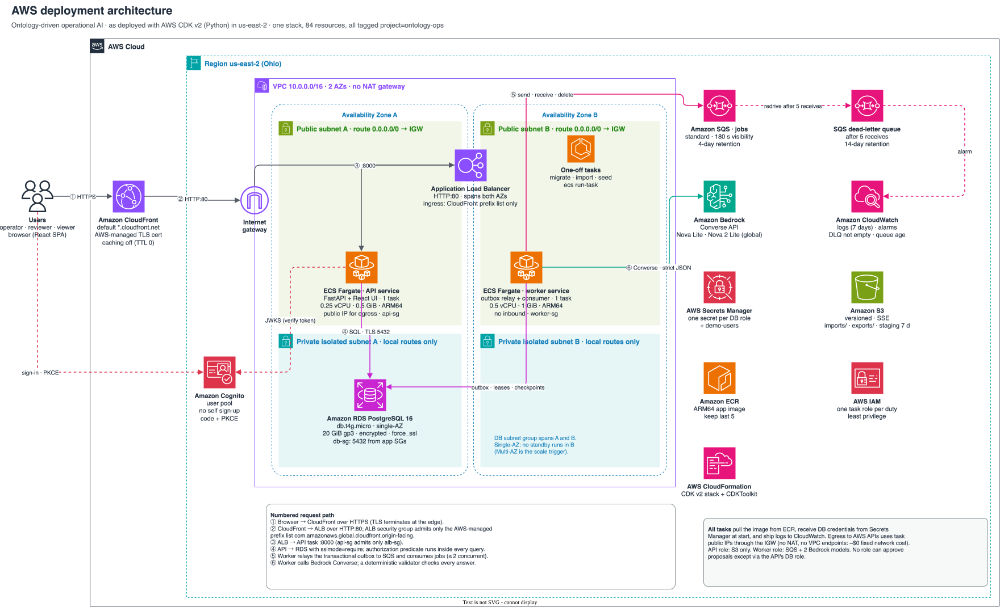

# Ontology Driven Operational AI

## Business problem

Delivery-exception investigation requires connected order, seller, customer, and product evidence. This build tests whether typed ontology evidence plus model assistance improves that decision over a deterministic workspace. Analyst effort and economic benefits remain untested; [the business case](docs/business_case.md) separates measured inputs from assumptions.

## User decision

Whether to open an evidence-supported **internal investigation** for a delivery exception. A seller relationship records fulfilment, not fault. All reads enforce explicit seller grants before joins and totals; a split-operator order is invisible to both operators. A proposal requires an independent reviewer with scope over every target. No customer message is sent, commerce record changed, or refund issued.

## Measured findings

The candidate **does not beat B0** by the predefined meaningful margin. On frozen gold-v1, B0 task success is **1.000** and the candidate's best cell is **0.581**. Candidate relationship precision is 1.000, but recall is at most 0.530. Accepted unsupported causal claims, authorization failures, and approval integrity failures were zero in the measured suites. Deployed warm read p95 was **591 ms** with 20 readers.

The evaluation ran from the owner's laptop against a local copy of the same data, with Bedrock in us-east-2. It was a within-family Nova generation comparison. The record run admitted 783 paid calls, costing **$0.3997 at list price from returned usage**. Human timing is untested. See [results and limitations](docs/results.md).

## Pilot recommendation

Recommend **B0, the deterministic workspace**. Do not fund the assisted candidate pilot on this evidence. Run a B0 timing/usability study before claiming productivity or ROI. Gold-v1 is perfect for B0 by construction and cannot demonstrate an AI advantage; any future assistance benchmark needs a separately reviewed design. See [pilot decision](docs/pilot.md).

## Evidence

- **Project site (GitHub Pages):** https://abh2050.github.io/ontology-ops/. It has a landing page, the [sandbox app](https://abh2050.github.io/ontology-ops/sandbox/), the [evidence replay](https://abh2050.github.io/ontology-ops/evidence/), and the architecture diagrams. The static apps use authored fixtures only, all actions are simulated, and browser tests verify zero `/api` requests.
- **Measured runs:** [M5 evaluation report](docs/evidence/eval/20261018T1745-bedrock/report.json), [deployed latency](docs/evidence/latency/deployed-m5.json), [fault-injection drills](docs/evidence/drills/), [HTTPS smoke](docs/evidence/smoke/), [teardown verification](docs/evidence/teardown-20261019.md).
- **Grouping:** [grouping measurement](docs/evidence/business_case.json) shows potential grouping from authorized queues, not measured intervention impact.

## Architecture



Seven diagrams drawn from the deployed CDK stack. Each has an editable draw.io source with official AWS icons and an SVG export; regenerate them with `uv run python scripts/build_diagrams.py`.

| Diagram | Shows |
|---|---|
| [Deployment architecture](docs/diagrams/aws-deployment.svg) | Region, VPC, 2 AZs, public and private-isolated subnets, CloudFront → ALB → Fargate API/worker → RDS, SQS + DLQ, Bedrock, Cognito, ECR, Secrets Manager, S3, CloudWatch, IAM |
| [Network and security](docs/diagrams/network-security.svg) | Security-group chain, routes, TLS and encryption at rest, accepted residual risk |
| [Authenticated read path](docs/diagrams/request-flow.svg) | Cognito code + PKCE, JWT verification, per-request scope |
| [Async AI job and approval](docs/diagrams/job-flow.svg) | Transactional outbox, SQS, leases, two Bedrock stages, validator, one-transaction approval, failure paths |
| [IAM and database roles](docs/diagrams/iam-and-db-roles.svg) | One IAM task role per duty; PostgreSQL role grants |
| [Deployment pipeline](docs/diagrams/deployment-pipeline.svg) | Preflight → CDK → image → one-off data tasks → release → verify → teardown |
| [Ontology](docs/diagrams/ontology.svg) | Typed objects, relationships, derived functions |

## Stack

React 19, TypeScript 5, Vite, Tailwind 4, TanStack Query, Cytoscape.js; Python 3.12, FastAPI, Pydantic 2; PostgreSQL 16, SQLAlchemy 2, psycopg 3, Alembic; boto3 Bedrock Converse; SQS/DLQ, Cognito, ECS Fargate, CloudFront, ALB, RDS, S3, Secrets Manager, ECR, CloudWatch; CDK v2 Python; pytest, Ruff, Playwright, local-only MLflow 3.

## Reproduction

```bash
uv sync --locked
docker compose up -d postgres
uv run ops migrate
uv run ops data import --directory data/fixtures --batch fixtures-v1 --download-date 2026-10-17
uv run ops data pick-as-of --batch fixtures-v1
uv run ops seed-users --mode local
uv run ops scenario generate --seed 42 --scenario base-v1
uv run uvicorn ops.api:app --host 127.0.0.1 --port 8000
```

In another terminal:

```bash
npm --prefix frontend ci
npm --prefix frontend run dev
```

Use a local token from `ops.auth.issue_local_token` in the local sign-in form. Tokens stay in session storage; do not save tokens in source files, screenshots, or logs. The local API refuses local identity mode outside `DEPLOY_ENV=local`. `uv run ops worker --queue fixture --provider fixture` runs the free deterministic stand-in; fixture output is not model evidence. The deployed worker uses Bedrock and incurs inference charges.

For full-data reproduction, obtain exactly the five required [Olist files](https://www.kaggle.com/datasets/olistbr/brazilian-ecommerce) with your own Kaggle account, place them under `data/raw/olist/`, then import, validate, pick-as-of, and seed users again. The data is CC BY-NC-SA 4.0 and is not redistributed in the static demos. See `uv run ops --help` and [the handoff](docs/HANDOFF.md).

```bash
uv run pytest -q
uv run ruff check .
npm --prefix frontend test
npm --prefix frontend run package:pages
```

`scripts/export_replay.py` regenerates the authored-only export from a seeded local database. Static replay is pinned to fixtures-v1 at 2018-03-15 23:59:59 dataset local and operator_a scope. Live builds load public Cognito identifiers from `/ui-config.json`; no browser AWS credentials are needed. Model IDs live only in `configs/models.yaml`. Paid evaluations and cloud releases require owner approval.

## Synthetic layer disclosure

Olist contains no carrier identities or causes of delay. Seeded fictional carriers and disruption events demonstrate context traversal, labelled **Synthetic scenario**. Temporal or regional overlap never establishes a cause. Authored commerce fixtures are labelled **Authored**, and static actions are explicitly simulations. The evidence replay uses deterministic queries of authored records; its simulated action text is hand-authored and is not a recorded model response.

## Limitations

Human investigation speed, operational error reduction, and financial return are untested. Gold-v1 cannot establish incremental AI value. There was one record run per cell, with no statistical significance test. Model outputs failed strict validation in 68 of 404 jobs. Multi-seller tests rely mainly on authored fixtures. Source timestamps are timezone-less and labelled dataset local; historical views mask later events. A displayed graph is capped at 50 nodes, separately from totals. The circuit breaker is process-local and assumes one worker.

## Cloud resource status

**Torn down on 2026-10-19.**
- The stack ran in **us-east-2** from 2026-10-17 to 2026-10-19 (decisions D-023 and D-024).
- `OntologyOpsStack` and `CDKToolkit` were deleted with **no final RDS snapshot**, as the owner chose. Direct service checks found no retained billable resources; see [teardown verification](docs/evidence/teardown-20261019.md).
- The estimated run rate while deployed was **$74.47/month**.
- Charges for the deployed period will still appear in billing after Cost Explorer's 24–48 h lag. They are not zero.
