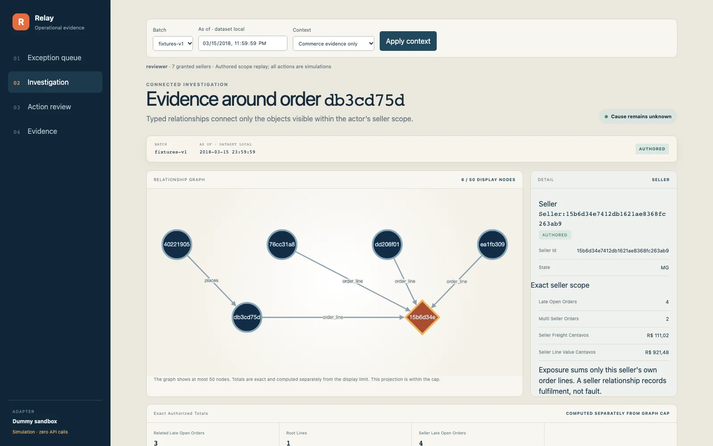
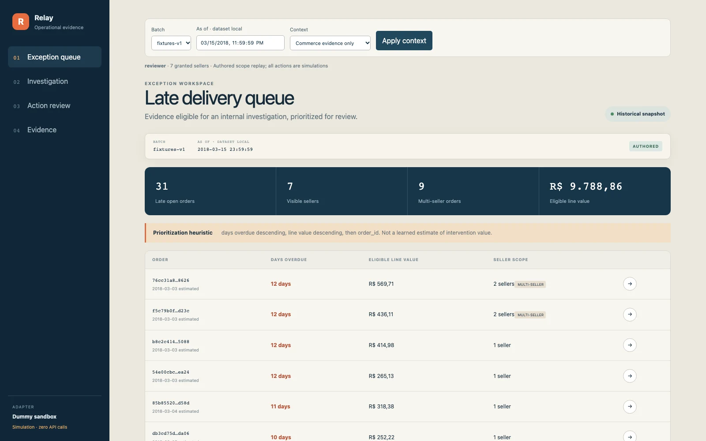
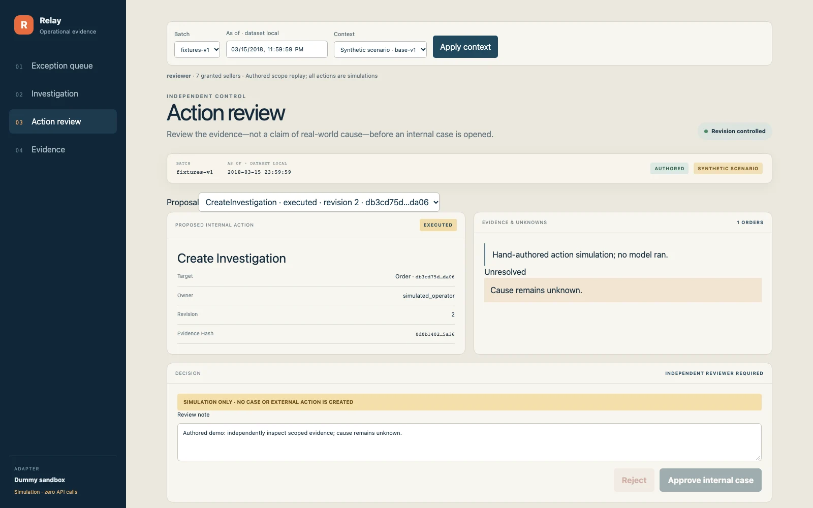
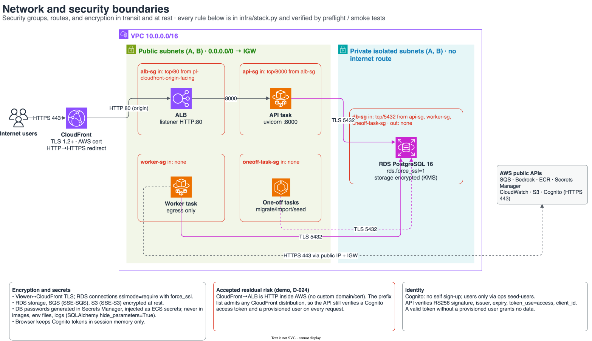
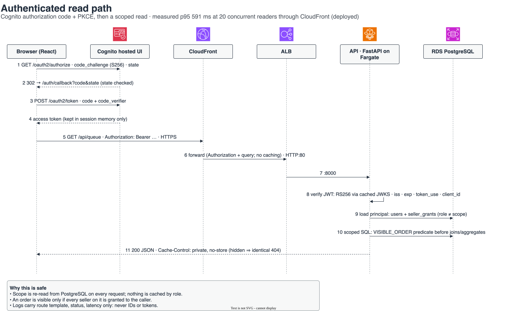
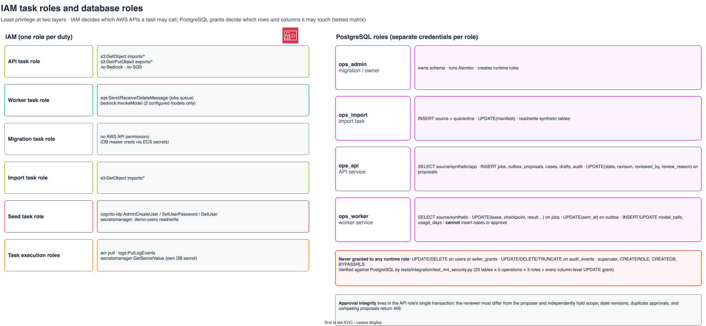
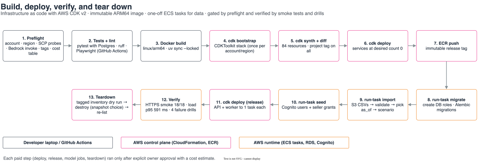
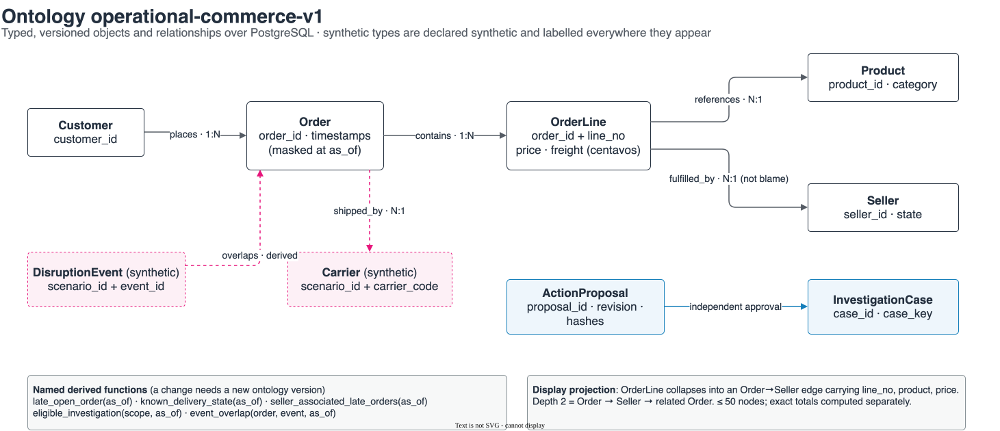

# Ontology Ops on AWS

**Turn late deliveries into focused investigations.**

An operations workspace that helps marketplace teams connect orders, sellers and products, find related delivery exceptions, and prepare an evidence-backed case for review. Built end to end, from the data pipeline and user interface to AI evaluation and AWS deployment.

[](https://github.com/abh2050/ontology-ops/actions/workflows/ci.yml)
&nbsp;**[Live site](https://abh2050.github.io/ontology-ops/)** · **[Try the sandbox app](https://abh2050.github.io/ontology-ops/sandbox/)** · **[System design](docs/system-design.md)** · **[Measured results](docs/results.md)**

## The business problem

An overdue-order report tells an operations analyst where to start. Preparing an investigation takes more work: look up the sellers and products, find other related late orders, calculate the affected value, and collect evidence for a team lead to review.

In the customer environment modeled by this project, that research spans separate exports, spreadsheets and review handoffs. Several late orders may share a seller, so the useful unit of work can be a **group of related orders**, rather than a separate investigation for every alert.

The business question is:

> **Which late orders should we investigate together, what evidence connects them, and who can approve the case?**

| Who uses it | What they need to accomplish |
|---|---|
| **Operations analyst** | Understand a delivery exception, find related orders and assemble a supported investigation proposal. |
| **Operations lead / reviewer** | Inspect the evidence, check the proposed scope and decide whether to open the internal case. |

This is a modeled operations workflow, not a claim about Olist's internal processes or an existing customer deployment.

## What the product does

| Step | In the workspace | The business purpose |
|---|---|---|
| **1. Find the exceptions** | Browse the authorized queue of late, undelivered orders at a selected historical date. | Give the analyst a consistent starting point for investigation. |
| **2. Connect the evidence** | Explore the order's sellers, products and related late orders; inspect exact counts and seller-level line values. | Bring related issues into one view while keeping quantities and monetary exposure accurate. |
| **3. Review the case** | Prepare an evidence-linked proposal and route it to a different, authorized reviewer. | Turn the research into a traceable internal investigation decision. |

**The value hypothesis:** less repeated evidence assembly, fewer overlapping investigations and clearer review handoffs. The build implements and tests the workflow; analyst time savings, observed case reduction and financial return still require a customer study. See the [business case](docs/business_case.md) for measured inputs and explicit assumptions.

## Product tour

### Connect an order to the wider investigation

The graph shows the business relationships around a selected order. The detail panel explains those relationships and reports the seller's exact exposure. Counts and totals are calculated separately from the graph's display limit.

[](https://abh2050.github.io/ontology-ops/sandbox/)

*Actual application capture using authored fixtures. Public-demo actions are simulations; this is not live model output. [Explore the sandbox →](https://abh2050.github.io/ontology-ops/sandbox/)*

<details>
<summary><b>See the exception queue and action-review screens</b></summary>

<table>
  <tr>
    <th>1. Find delivery exceptions</th>
    <th>3. Review the internal case</th>
  </tr>
  <tr>
    <td></td>
    <td></td>
  </tr>
  <tr>
    <td>Select the data context and open an order for investigation. Queue sorting is a heuristic.</td>
    <td>Inspect the proposal and its review state. The backend enforces independent approval; the static demo simulates the action.</td>
  </tr>
</table>

All three screenshots show the implemented UI with authored data. They illustrate the product experience, not measured improvements in analyst performance.

</details>

### Where the ontology and AI fit

An **ontology** is the shared business vocabulary: a customer places an order, an order contains lines, and each line belongs to a seller and a product. The application uses these typed relationships consistently across the graph, evidence tools and recommendations.

The AI-assisted path adds two bounded stages: a planner selects evidence tools, then an analyst drafts cited findings and a proposed internal action. Deterministic software owns permissions, exact calculations, evidence checks and execution. A separate reviewer makes the approval decision.

The project evaluates whether that assistance adds value over a deterministic workspace using the same facts. The [recorded comparison and recommendation](#measured-results) appear after the architecture and system-design walkthrough.

**The user decides only one thing:** whether to open an evidence-supported **internal** investigation. The system never contacts customers, issues refunds, edits commerce records, or claims to know the cause of a delay. A seller relationship records who fulfilled a line, not who is at fault.

---

## From product to implementation

The sections below cover what was built, how the AWS services work together, the engineering decisions, and the measured results.


## At a glance

| | |
|---|---|
| **What it is** | An operations tool that connects orders, sellers, products, and customers through a typed **ontology**, lets two bounded **Amazon Bedrock** stages draft an investigation proposal, checks every answer with deterministic code, and requires an **independent human reviewer** before any case is opened. |
| **What I built** | The full stack: data import of 99k+ real orders, ontology and authorization layer, FastAPI backend, async job pipeline, AI agents and validator, React UI, and AWS infrastructure in **CDK (Python)**. It was deployed, load-tested, failure-drilled, evaluated, and torn down. |
| **AWS services** | CloudFront · ALB · ECS Fargate (ARM64) · RDS PostgreSQL 16 · SQS + DLQ · Amazon Bedrock · Cognito · Secrets Manager · S3 · ECR · CloudWatch · IAM · CloudFormation/CDK |
| **Headline numbers** | **591 ms** p95 read latency at 20 concurrent users (target 750) · **18/18** HTTPS security checks · **4/4** live failure drills passed · **0** unauthorized reads or approvals accepted · **$0.0004–$0.002** AI cost per job · full dataset import in **9.3 s** |
| **Honest outcome** | The AI workflow did **not** beat the deterministic baseline (task success 0.581 vs 1.000), so the recommendation is to ship the simpler non-AI workspace. Knowing when *not* to ship AI is part of the result. |

## What this project demonstrates

| Skill | Evidence in this repo |
|---|---|
| **AWS architecture** | One CDK stack: VPC across 2 AZs, public and private-isolated subnets, no NAT, CloudFront in front of an ALB locked to CloudFront's prefix list, private RDS → [diagrams](#aws-architecture) |
| **Infrastructure as code and delivery** | AWS CDK v2 (Python), a 13-step deploy pipeline with a preflight gate, one-off ECS tasks for migrations and data, tagged teardown → [pipeline](docs/diagrams/deployment-pipeline.svg) |
| **Distributed systems** | Transactional outbox → SQS, leases, checkpoints, idempotency keys, DLQ, circuit breaker, logical CQRS with optimistic concurrency → [system design](#system-design) |
| **Reliability engineering** | Live fault injection on the deployed stack: worker crash before acknowledgement, Bedrock timeout, provider rejections, poison message → [drills](docs/evidence/drills/) |
| **Security** | Cognito auth-code + PKCE, JWT verification, seller-level authorization inside every SQL query, one IAM role and one database role per duty, secrets never in code or logs → [network and security](docs/diagrams/network-security.svg) |
| **Applied AI with guardrails** | Two bounded Bedrock stages with strict JSON contracts; a deterministic validator rejects invented IDs, model-made arithmetic, and causal claims; the paid-call budget is enforced in the database → [job flow](docs/diagrams/job-flow.svg) |
| **Data engineering** | Full Olist dataset (99,441 orders) with strict validation, a quarantine with reason codes, money as integer centavos, historical as-of masking, reproducible manifests |
| **Evaluation and judgement** | A frozen 60-question benchmark, B0/B1/candidate comparators across 2 models and 2 modes, independent SQL oracles, a pre-registered success margin → [results](docs/results.md) |
| **Frontend** | React 19, TypeScript, TanStack Query, Cytoscape.js graph, three adapters (live, evidence replay, sandbox), Playwright tests |

---

## AWS architecture

Thirteen diagrams, drawn from the deployed CDK stack and the code. Each one has an editable [draw.io source](docs/diagrams/) using the official AWS icon set. Regenerate them with `uv run python scripts/build_diagrams.py`.

### Deployment
Region, VPC, two Availability Zones, public subnets for the ALB and Fargate tasks, private-isolated subnets for RDS, and the regional managed services. *(Shown at the top of this page.)* [Full size](docs/diagrams/aws-deployment.svg)

### Network and security boundaries
The security-group chain (CloudFront prefix list → ALB → API → RDS), the route tables, encryption in transit and at rest, and the one accepted residual risk.



### Authenticated read path
Cognito sign-in with authorization code + PKCE, access-token verification, and a permission check reloaded from PostgreSQL on every request.



### Async AI job and independent approval
Transactional outbox → SQS → leased worker → Bedrock planner and analyst → deterministic validator → reviewer approval in one database transaction, with every failure path.


### IAM task roles and database roles
Least privilege at two layers: which AWS APIs each task may call, and which rows and columns each database role may touch. The grant matrix is verified by tests against PostgreSQL.



### Build, deploy, verify, tear down
Preflight gates, CDK bootstrap/synth/diff/deploy, immutable ARM64 image, one-off ECS tasks for migration, import, and seeding, release, smoke tests and drills, and tagged teardown.



### Ontology data model
Typed objects and relationships with cardinality. Synthetic carrier and disruption types are marked and labelled everywhere they appear.



---

## System design

Six workload scenarios. Each one maps to a mechanism that was built, measured evidence, and a recorded **scale trigger** for the service deliberately not built yet. Full write-up: **[docs/system-design.md](docs/system-design.md)**.


| Scenario | Built | Measured | Deferred until |
|---|---|---|---|
| Too many reads | Indexes, index-range predicate, keyset pagination, ETags, metadata cache, `private, no-store` | p95 **591 ms** at 20 users | p95 > 750 ms → read replica; repeated scoped reads → scoped cache |
| Too many writes | COPY in 1,000-row batches in one transaction, quarantine, append-only audit | **9.3 s** full import; identical re-import is a no-op | Incremental imports → partitioning and upserts (no sharding) |
| Timely updates | Polling with ETag/304 and exponential idle backoff (2 → 15 s) | Browser tests | Many sub-second watchers → SSE/WebSockets |
| Slow jobs | 202 + job ID, outbox → SQS, bounded worker, leases, checkpoints | Deployed jobs 10–16 s | Queue depth → autoscale workers |
| Failures | Idempotency, paid-call reservation, no SDK retries, DLQ, circuit breaker | **4/4** live drills | More than 1 worker → fleet-wide breaker |
| Read/write contention | Logical CQRS, revision → 409, row and advisory locks, unique keys | 4 concurrent approvals → **1** case | Measured contention → separate read store |

### 1. Scaling reads


### 2. The write path


### 3. Timely updates: polling with exponential backoff


### 4–5. Slow jobs and failures: state machines


### 6. Read/write contention: logical CQRS


---

## Measured results

Every number below comes from a recorded run. Targets are not results.

| Area | Result | Target | |
|---|---|---|---|
| Read latency (deployed, 20 concurrent users) | p95 **591 ms**, 0 errors | < 750 ms | ✅ |
| AI job latency | p95 ≤ 4.4 s per job | < 60 s | ✅ |
| Authorization and approval failures accepted | **0** across 20 security scenarios and 18 HTTPS checks | 0 | ✅ |
| Unsupported causal claims accepted | **0** (44 caught and sent to review) | 0 | ✅ |
| Live failure drills | **4 / 4** | — | ✅ |
| AI investigation task success | **0.581** (best cell) vs **1.000** for the deterministic baseline | ≥ 0.90 | ❌ |
| Relationship recall | ≤ 0.53 (precision 1.000) | ≥ 0.95 | ❌ |
| Human time saved | untested | ≥ 25 % | — |

**Recommendation: ship the deterministic workspace (B0).**
- The AI candidate did not clear the pre-registered success margin over the non-AI baseline.
- Typed ontology evidence beat the same facts served flat by +4.7 to +21.7 points on Nova Lite, and every safety control held.
- On this benchmark, though, the baseline already answers correctly.

Details: [results](docs/results.md) · [pilot decision](docs/pilot.md) · [business case](docs/business_case.md) · [raw evaluation report](docs/evidence/eval/20261018T1745-bedrock/report.json)

**AI spend:** the whole evaluation, including two runs that were stopped and fixed, cost about **$0.71** in Bedrock calls. The deployed stack's estimated run rate was about **$74/month**, from AWS Price List rates.

## Engineering highlights

- **Profiling beat guessing.** The first load test missed its latency target (p95 947 ms). Profiling showed the API re-parsing its signing key on every request, so the cause was CPU, not the database. Caching the parsed key brought p95 down to 189 ms locally without adding a read replica.
- **Exactly-once outcome on at-least-once delivery.** A live drill killed the worker after it finished a job but before acknowledging SQS. The message was redelivered, the new worker recognised the finished job, and exactly **one** case was opened. A repeat approval returned 409.
- **A cloud constraint, diagnosed.** The AWS account's organization policy blocked core services in us-east-1. Read-only probes per region found the one region that allowed them (us-east-2), and the decision was recorded as D-023.
- **A secret leak caught and closed.** A failed migration printed a database password into CloudWatch through an ORM error message. The log stream was deleted, the secret rotated, and every database engine switched to `hide_parameters=True`, with a test.
- **AI guardrails that measurably work.** The validator caught 44 causal claims, model-made arithmetic, and invented IDs before anything reached a reviewer. Paid model calls are reserved in PostgreSQL before they are sent, so a crash can never cause a silent second charge.

## Try it

- **No setup:** open the [sandbox app](https://abh2050.github.io/ontology-ops/sandbox/) or the [evidence replay](https://abh2050.github.io/ontology-ops/evidence/). They run fully in the browser on authored fixture data; all actions are simulated and no API calls are made (verified by Playwright).
- **Run locally** (Docker, Python 3.12 with `uv`, Node 22):

```bash
uv sync --locked
docker compose up -d postgres
uv run ops migrate
uv run ops data import --directory data/fixtures --batch fixtures-v1 --download-date 2026-10-17
uv run ops data pick-as-of --batch fixtures-v1
uv run ops seed-users --mode local
uv run ops scenario generate --seed 42 --scenario base-v1
uv run uvicorn ops.api:app --host 127.0.0.1 --port 8000   # API
uv run ops worker --queue fixture --provider fixture        # free deterministic worker
npm --prefix frontend ci && npm --prefix frontend run dev   # UI
```

<details>
<summary><b>Full reproduction, tests, and cloud deployment</b></summary>

**Tests**

```bash
uv run pytest -q              # 287 backend tests (unit + PostgreSQL integration)
uv run ruff check .
npm --prefix frontend test    # Playwright, including zero-API checks for static apps
```

**Full dataset.** Download exactly the five required [Olist files](https://www.kaggle.com/datasets/olistbr/brazilian-ecommerce) with your own Kaggle account into `data/raw/olist/`. Then run `ops data import`, `validate`, `pick-as-of`, and `seed-users`. The data is CC BY-NC-SA 4.0 and is not redistributed here.

**Local sign-in.** Mint a token with `ops.auth.issue_local_token('operator_a')`. Local identity mode refuses to start outside `DEPLOY_ENV=local`. Fixture-worker output is not model evidence.

**Evaluation.** Run `uv run ops eval --suite frozen --provider fixture` for a free dry run. The `--provider bedrock --confirm-paid` mode makes paid calls. Model IDs live only in `configs/models.yaml`.

**AWS.** Deployment is driven by `scripts/deploy.py` (`preflight`, `diff`, `infra`, `image`, `upload-data`, `task migrate|import|seed`, `release`, `smoke`). Every paid step needs explicit approval. `scripts/teardown.py` prints the tagged inventory first. See [HANDOFF.md](docs/HANDOFF.md) and the [decisions log](docs/decisions.md).

</details>

## Tech stack

| Layer | Technology |
|---|---|
| Frontend | React 19, TypeScript 5, Vite, Tailwind CSS 4, TanStack Query, Cytoscape.js |
| Backend | Python 3.12, FastAPI, Uvicorn, Pydantic 2 |
| Data | PostgreSQL 16, SQLAlchemy 2, psycopg 3, Alembic |
| AI | Amazon Bedrock Converse (Nova Lite, Nova 2 Lite) with strict client-side Pydantic validation |
| AWS | CloudFront, ALB, ECS Fargate, RDS, SQS + DLQ, Cognito, Secrets Manager, S3, ECR, CloudWatch, IAM |
| IaC / CI | AWS CDK v2 (Python), GitHub Actions, GitHub Pages |
| Quality | pytest, Ruff, Playwright, MLflow 3 (local tracking) |

## Repository map

```
backend/ops/      API, auth, ontology, queries (authorized tools), commands (approval),
                  agents (planner, analyst, validator), jobs (outbox, consumer, breaker), evals
infra/            AWS CDK stack (Python)
frontend/         React app: live, evidence-replay, and sandbox adapters
scripts/          deploy, teardown, drills, load test, diagrams, gold-set tools
docs/             site (index.html), diagrams/, system-design.md, results.md, decisions.md,
                  evidence/ (latency, drills, smoke, eval, teardown), progress/ (M1–M6)
data/             fixtures (authored), gold set (frozen benchmark), scenarios
```

## Data, synthetic layer, and limitations

- **Data.** Brazilian E-Commerce Public Dataset by Olist, CC BY-NC-SA 4.0. The public apps use authored fixtures only.
- **Synthetic layer.** Olist has no carriers or causes of delay. Fictional carriers and disruption events demonstrate context traversal and are labelled **Synthetic scenario** everywhere. Overlap in time or region never establishes a cause.
- **Limitations.**
  - Human time savings and financial return are untested.
  - This benchmark cannot show AI advantage, because the baseline is perfect by construction.
  - There was one evaluation run per cell.
  - 68 of 404 AI jobs failed strict output validation.
  - Multi-seller cases rely mainly on authored fixtures.
  - The circuit breaker is process-local, which assumes one worker.

## Cloud status

**Torn down on 2026-10-19.**
- The stack ran in us-east-2 from 2026-10-17 to 2026-10-19 and was then deleted, including the CDK bootstrap, with no database snapshot kept.
- Direct service checks found no retained billable resources → [teardown verification](docs/evidence/teardown-20261019.md).
- Charges for the deployed period will still appear in billing after Cost Explorer's lag.

---

<sub>Built by Abhishek Shah · Specification: [docs/prd.md](docs/prd.md) · Decisions: [docs/decisions.md](docs/decisions.md) · Milestone reports: [docs/progress/](docs/progress/)</sub>
