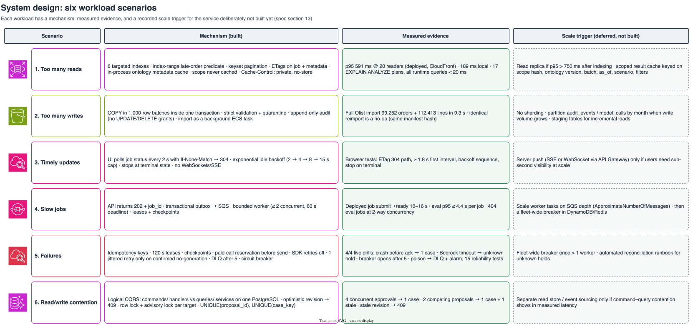
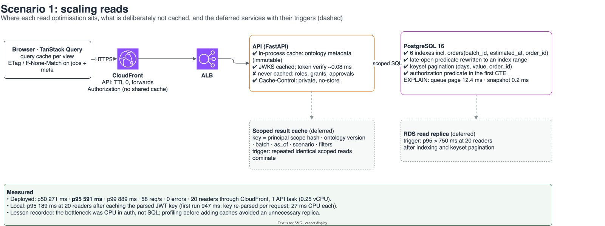
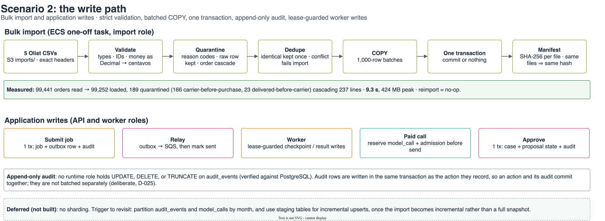
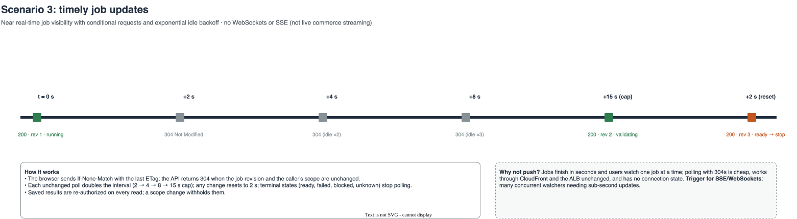
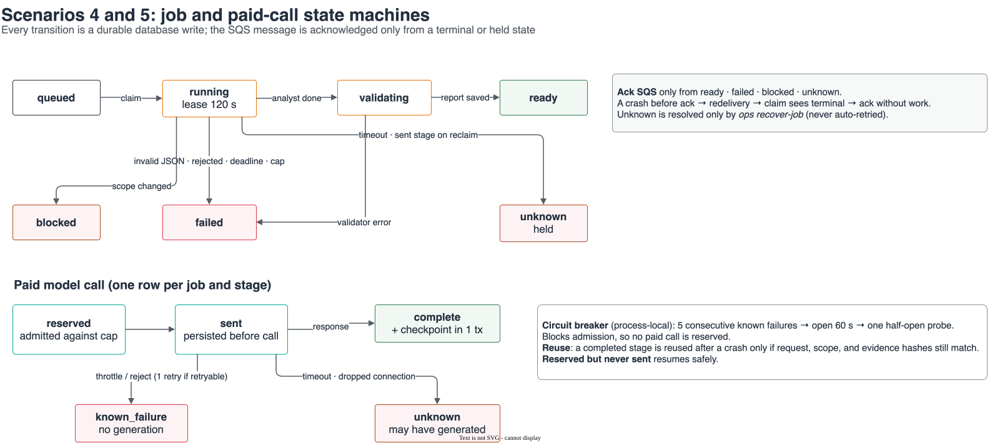
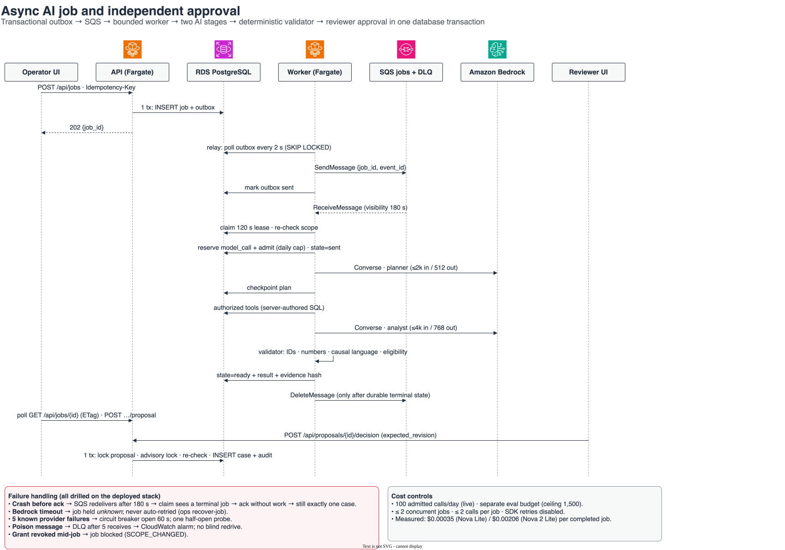
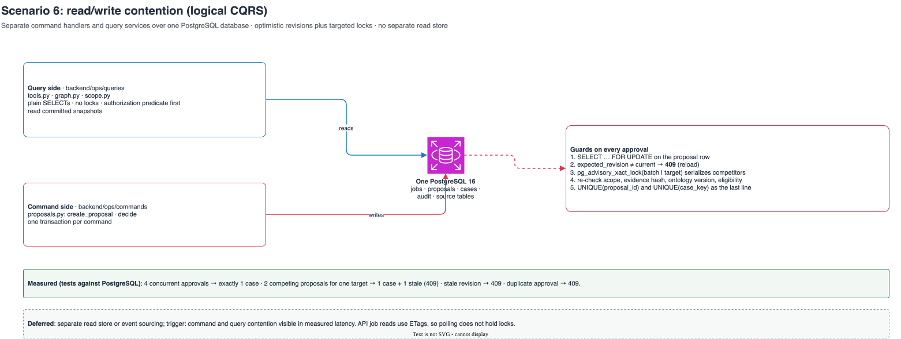

# System design

The specification (section 13) names six workload scenarios. For each one, this page gives:
- the mechanism that was **built**
- the code that implements it
- the **measured** evidence from local and deployed runs
- the **scale trigger** for the service deliberately **not built yet**

Diagrams are in [`docs/diagrams/`](diagrams/). Each has an editable `.drawio` source using official AWS icons and an SVG export, regenerated with `uv run python scripts/build_diagrams.py`.

| # | Scenario | Built | Measured | Deferred, with trigger |
|---|---|---|---|---|
| 1 | Too many reads | Indexes, index-range predicate, keyset pagination, ETags, in-process metadata cache, `private, no-store` | p95 **591 ms** at 20 readers (deployed); 189 ms locally | Read replica; scoped result cache |
| 2 | Too many writes | COPY in 1,000-row batches in one transaction, quarantine, append-only audit, background import task | Full Olist import in **9.3 s**; reimport is a no-op | Partitioning; incremental staging upserts; no sharding |
| 3 | Timely updates | 2 s polling with ETag/304, exponential idle backoff to 15 s, stop at terminal | Browser tests for 304, interval, backoff, and stop | SSE or WebSockets |
| 4 | Slow jobs | 202 + job ID, transactional outbox → SQS, worker capped at 2 jobs, 60 s deadline | Deployed job 10–16 s; evaluation p95 ≤ 4.4 s | Autoscale workers on SQS depth |
| 5 | Failures | Idempotency keys, leases, checkpoints, paid-call reservation, no SDK retries, DLQ, circuit breaker | **4/4 live drills**; 15 reliability tests | Fleet-wide breaker; reconciliation runbook |
| 6 | Read/write contention | Logical CQRS on one database, optimistic revision → 409, row and advisory locks, unique keys | 4 concurrent approvals → 1 case; competing proposals → 1 case | Separate read store or event sourcing |

---

## 1. Too many reads

**Mechanisms (built)**
- **Indexes.** Six required indexes, including `orders(batch_id, estimated_at, order_id)` and `order_items(batch_id, seller_id, order_id)` (`db/versions/0001_initial.py`).
- **Index-range predicate.** The late-open predicate is written as `estimated_at < date(as_of)` and `>= date(as_of) − 30`, so the 30-day cap becomes an index range scan (`backend/ops/queries/late_orders.py`).
- **Keyset pagination.** On (days overdue, line value, order_id), never OFFSET (`backend/ops/queries/tools.py`, `find_late_orders`).
- **ETags.** On `/api/jobs/{id}` and `/api/meta`; clients send `If-None-Match` and get 304 (`backend/ops/api.py`).
- **In-process caching.** Only immutable ontology metadata and the parsed token key are cached (`registry()`, `_ontology_meta()`, `_local_public_key()`).
- **Never cached.** Roles, grants, approvals: the principal is reloaded from PostgreSQL on every request (`backend/ops/queries/scope.py`). Data responses carry `Cache-Control: private, no-store`, and CloudFront forwards `Authorization` with a 0 s TTL.

**Measured**
- **Deployed.** 20 concurrent readers through CloudFront to one 0.25-vCPU API task: p50 271 ms, **p95 591 ms**, p99 889 ms, 58 req/s, 0 errors (`docs/evidence/latency/deployed-m5.json`).
- **Locally.** p95 189 ms at 20 readers (`docs/evidence/latency/local-m2.json`).
- **Query plans.** EXPLAIN ANALYZE for all 17 runtime queries (`docs/evidence/explain/`): queue page 12.4 ms, order snapshot 0.2 ms.
- **Lesson.** The first local run measured p95 947 ms. Profiling showed the cause was the API re-parsing the RSA key on every request (27 ms of CPU), not SQL. Caching the parsed key fixed it, so no replica or result cache was added before it was needed.

**Deferred**
- **RDS read replica.** Trigger: p95 above 750 ms at 20 readers after indexing and keyset pagination.
- **Scoped result cache.** Keyed on principal scope hash, ontology version, batch, as_of, scenario, and filters. Trigger: repeated identical scoped reads dominate load.

## 2. Too many writes

**Mechanisms (built)**
- **Validation.** Strict header and type validation; money parsed with `Decimal` and rounded half up to integer centavos.
- **Quarantine.** Every rejected row is kept with a reason code. Quarantining an order cascades to its lines (`backend/ops/data/importer.py`).
- **Bulk load.** `COPY` in 1,000-row batches inside a single transaction: the import commits completely or not at all.
- **Idempotent reimport.** The batch ID derives from the file hashes, so importing the same files again is a no-op with the same manifest hash.
- **Background import.** On AWS it runs as a one-off ECS task with its own role, never inside the API.
- **Application writes are transactional.**
  - A submitted job, its outbox row, and its audit event commit together.
  - An approval writes the case, the proposal state, and the audit event in one transaction.
  - Worker writes are lease-guarded.
  - A paid model call is reserved and admitted before it is sent.
- **Append-only audit.** No runtime role can update, delete, or truncate `audit_events`. A test checks this against PostgreSQL.

**Measured**
- **Full Olist import.** 99,441 orders read and 99,252 loaded. 189 orders were quarantined, cascading 237 lines. **9.3 s**, 424 MB peak.
- **On AWS.** The same counts were reproduced.

**Deliberate differences from the spec wording (D-025)**
- **Inserts, not upserts.** Imports are full immutable snapshots, so a new batch is an insert, and an identical batch is detected and skipped.
- **Audit rows are not batched separately.** Each audit row commits in the same transaction as the action it records, which keeps the action and its audit atomic.

**Deferred**
- **No sharding.**
- **Partitioning.** Partition `audit_events` and `model_calls` by month, and add staging-table upserts, once imports become incremental instead of full snapshots.

## 3. Timely updates

**Mechanisms (built)**
- **Conditional polling.** The UI polls `GET /api/jobs/{id}` every 2 s with `If-None-Match`. The API returns 304 while the job revision and the caller's scope are unchanged.
- **Idle backoff.** Each unchanged poll doubles the interval: 2 → 4 → 8 → 15 s cap. Any change resets it to 2 s, and terminal states stop polling (`frontend/src/polling.ts`, `frontend/src/JobAction.tsx`).
- **Re-authorized reads.** Saved results are re-checked on every read; if the caller's scope has changed, the result is withheld.
- **No push channel.** No WebSockets or SSE. This is near real-time job visibility, not live commerce streaming.

**Measured**
- `frontend/tests/polling.spec.ts`: the backoff sequence, reset on change, and one count per fetch.
- `frontend/tests/live.spec.ts`: the ETag/304 path, a first interval of at least 1.8 s, and stop at terminal.

**Deferred**
- **SSE or WebSocket push.** Trigger: many concurrent watchers who need sub-second updates.

## 4. Slow jobs and 5. Failures

**Mechanisms (built)**
- **Asynchronous submission.** The API returns 202 with a job ID. A transactional outbox avoids dual writes; the worker relays outbox rows to SQS every 2 s and marks a row sent only after SQS accepts it.
- **Bounded worker.** At most two concurrent jobs and a 60 s workflow deadline.
- **Leases and checkpoints.** A 120 s lease with a random token, and a checkpoint after each stage. The SQS message is acknowledged only after a durable terminal or held state.
- **Paid calls.**
  - Each call reserves a unique row and is admitted against the daily cap before it is sent.
  - SDK retries are off.
  - One jittered retry happens only when the provider confirms nothing was generated.
  - An unknown outcome is held, never retried automatically.
- **Circuit breaker.** Five known failures open the breaker for 60 s, followed by one half-open probe.
- **Poison messages.** After 5 receives a message moves to the DLQ, and a CloudWatch alarm fires.

**Measured (live drills on the deployed stack, `docs/evidence/drills/`)**
- **Worker crash before acknowledging SQS.** SQS redelivered the message, the new worker saw the job was already finished and acknowledged it without repeating work, and exactly one case resulted. A repeat approval returned 409.
- **Bedrock read timeout.** The job was held as unknown and not retried.
- **Five real Bedrock rejections.** The breaker opened, and the sixth job was refused without a paid admission.
- **Poison message.** It reached the DLQ, and the DLQ alarm went into ALARM.
- **Locally.** 15 reliability scenarios pass (`data/gold/reliability_scenarios.yaml`).

**Deferred**
- **Worker autoscaling** on SQS queue depth.
- **Fleet-wide breaker**, needed once more than one worker runs.
- **Automated reconciliation** for unknown holds.

## 6. Read/write contention

**Mechanisms (built)**
- **Command side.** `backend/ops/commands/proposals.py` handles proposal creation and decisions, one transaction per command.
- **Query side.** `backend/ops/queries/` holds the query services: plain SELECTs with no locks.
- **Approval guards.**
  - A row lock on the proposal.
  - An optimistic `expected_revision` check, returning **409** when stale.
  - `pg_advisory_xact_lock` on the target, so competing proposals serialize.
  - Re-checks of scope, evidence hash, ontology version, and eligibility.
  - `UNIQUE(proposal_id)` and `UNIQUE(case_key)` as the final guard.

**Measured (`tests/integration/test_m4_actions.py`)**
- 4 concurrent approvals → exactly 1 case.
- 2 competing proposals → 1 case and 1 stale.
- A stale revision → 409.

**Deferred**
- **Separate read store or event sourcing.** Trigger: command-query contention visible in measured latency.

---

Related diagrams: [AWS deployment](diagrams/aws-deployment.svg) · [network and security](diagrams/network-security.svg) · [authenticated read path](diagrams/request-flow.svg) · [IAM and DB roles](diagrams/iam-and-db-roles.svg) · [deployment pipeline](diagrams/deployment-pipeline.svg) · [ontology](diagrams/ontology.svg).
